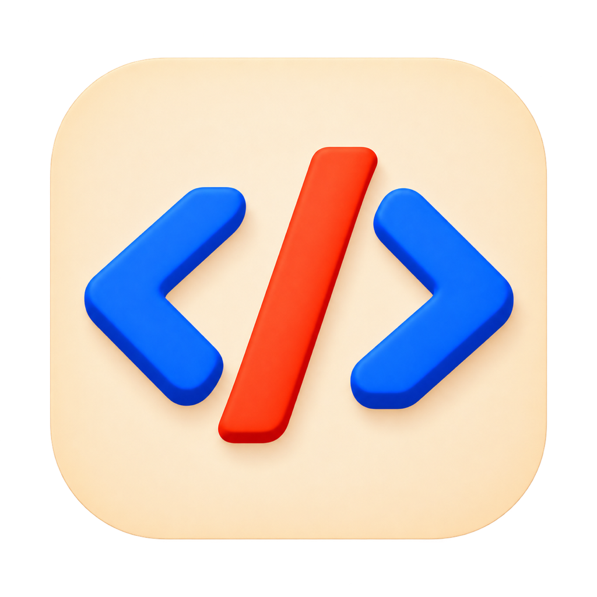

# HyCode



A high-performance, native macOS code editor — built with Swift and Rust, fully open source.

HyCode 是高性能、轻量、原生的开源代码编辑器。首版专注 **macOS（Apple Silicon）**，采用 **Swift 原生界面 + Rust 内核**，借鉴 IDEA 的工作台组织，追求快速启动、低输入延迟和可控的资源占用。

**当前已建立 macOS 文件工作台和基础文本编辑。** 启动恢复上次项目，项目树单击文件进入原生编辑；默认停止输入 800 ms 后自动保存，可在设置关闭，也可使用 ⌘S。文件使用独立撤销历史，首次修改固定标签，保存冲突保留更改；目录只在树中浏览。当前支持 UTF-8 与带 BOM 的 UTF-16 文本；超过 8 MiB 或长行自动采用[磁盘分段编辑](docs/LARGE_FILES.md)，支持 GB 级文本的定位、整文件字面查找和完整保存，已接入逻辑行号和 Dart、Web、C/C++、Rust 等语言的基础着色；Dart/Flutter 已接入外部 SDK 分析器的诊断、悬浮、定义/引用、显式补全和格式化，以及 Pub 依赖管理，详见 [Dart/Flutter 工具](docs/DART_FLUTTER.md)。Flutter 已增加运行/调试、热更新、测试/构建和基础 Inspector 入口，真实 Flutter/设备仍未验证；完整 DevTools、智能补全与跨文件重构等缺口见[完整能力清单](docs/FLUTTER_PLAN.md)。静默构建与后台测试已通过，真实输入、窗口及性能尚未验证。旧实现保留在 Git 历史中，尚无正式应用发布。

- 源码：[hhcme/hy_code](https://github.com/hhcme/hy_code)
- 许可证：[MIT](LICENSE)
- 反馈与需求：[GitHub Issues](https://github.com/hhcme/hy_code/issues)
- 参与贡献：[CONTRIBUTING.md](CONTRIBUTING.md)

Web 已接入 JS/TS/JSX/TSX、Vue、HTML/CSS/SCSS/LESS、JSON/JSONC 的按需语言服务、诊断/导航、显式补全/自动导入、重命名/代码动作修改预览及 package scripts/依赖入口。需要外部 Node 22.22.2+，Vue 项目插件须显式信任。打开项目自动执行后台诊断，左下角汇总错误/警告/建议并可定位；编辑后检查变动及关联文件，范围/资源限制见[项目后台分析](docs/PROJECT_ANALYSIS.md)。全部目标、当前实现及剩余功能见 [Web 开发工具](docs/WEB_TOOLS.md)；Web 调试器、测试树与框架专用工具仍未完成。

JSON/JSONC 与 YAML/YML 已增加语法检查、离线 Schema 验证、字段补全、悬浮说明、结构和格式化；常见清单规则及安全读取范围见[配置文件工具](docs/CONFIGURATION_TOOLS.md)。服务与解析在后台执行，不加载项目 Prettier 配置或自动下载 Schema。

底栏增加[自身资源监控](docs/PERFORMANCE_MONITOR.md)：每 2 秒显示主进程内存/CPU，可清理自身闲置语法缓存，保留未保存内容、撤销记录和当前文件缓存。子服务占用未计入；真实窗口与回收效果仍待验收。

内置 [Codex Agent](docs/CODEX_AGENT.md) 默认位于右侧，按用户 Codex 截图和录屏调整原生消息流、可展开工具活动、改动汇总及圆角输入区，支持 HyCode 默认服务与项目自定义 Responses、多个对话、流式输出和停止。提供 DeepSeek V4 Pro/Flash 预设，默认最高思考 max 与 1M 上下文，各对话可调。两个只读任务可并行，修改任务独占并保护已保存文档；系统 CLI/官方 App 的配置和登录保持独立。固定原版运行时已接入，DeepSeek 无工具接口曾验证；API Key 由 HyCode 专用本地文件管理，不使用系统钥匙串。真实模型工具环路和窗口交互尚未验收。

## 产品方向

- **先做好代码编辑**：本地文件与项目目录、项目树、多标签、面包屑、可靠编辑与安全保存。
- **macOS 原生体验**：Swift 开发，保留系统输入法、菜单、快捷键、窗口和无障碍行为；SwiftUI/AppKit 的具体组合通过原型确定。
- **Rust 内核**：承载文档、编辑事务、搜索与后台任务；语法解析和语言服务按需接入，避免阻塞界面。
- **实测性能**：启动、输入、滚动、文件加载、搜索、内存及取消恢复分别测量；尚未公布性能结果，磁盘分段编辑的后台 GB 样本不代表真实窗口性能已达标。
- **复用开源生态**：允许采用官方和社区的开源组件，按职责、维护情况、性能和许可选择；不要求所有依赖均由 Rust 实现。
- **完整开源**：原生界面、核心、桥接、构建和文档均纳入公开源码，不依赖私有编辑内核或必须登录的后台。

高亮、补全、导航、Git、终端与任务逐阶段增加；首批语言和首个可交付版本的具体范围仍需评审。其他平台属于未来议题，不纳入首版计划。图片已接入只读预览，支持缩放、适应窗口、原始尺寸与拖动；常见位图使用 ImageIO，SVG 使用受限的 Rust resvg。多帧首帧、格式与资源限制见[图片预览](docs/IMAGE_PREVIEW.md)。本地 MP4/MOV/M4V 已接入简单只读视频预览，默认暂停，提供播放、进度和音量，范围见[视频预览](docs/VIDEO_PREVIEW.md)。Markdown/HTML 已接入源码、左右分屏与静态只读预览，支持未保存刷新、比例和滚动联动，范围见[分屏预览](docs/MARKUP_PREVIEW.md)。Swift/Java 已接入外部 SourceKit-LSP/JDT LS，SQL 已接入离线检查、格式化及项目 DDL 补全/导航；工具、项目导入信任及限制见[原生语言](docs/NATIVE_LANGUAGES.md)和[语言扩展目标](docs/LANGUAGE_EXPANSION_PLAN.md)；PDF 与归档仍为后续配套能力。

## 文档导航

完整目录与阅读顺序见 [docs/README.md](docs/README.md)。

| 文档 | 内容 |
| --- | --- |
| [方向与已定事项](docs/EDITOR_DIRECTION.md) | 已确认范围与尚未决定的事项 |
| [产品需求](docs/PRODUCT_REQUIREMENTS.md) | 工作区、编辑、保存和工作台交互 |
| [技术设计](docs/TECH_DESIGN.md) | Swift/Rust 分层、文档所有权和 FFI |
| [开发约定](docs/DEVELOPMENT.md) | 开发入口、真实命令、验证与证据规则 |
| [内置 Codex Agent](docs/CODEX_AGENT.md) | 右侧多会话、自定义服务、凭据与运行隔离、后台证据 |
| [品牌与应用图标](docs/BRANDING.md) | 同系列设计、资源、提示词与打包 |
| [当前文件工作台](docs/WORKBENCH.md) | 布局、交互、源码地图、构建及验证边界 |
| [Markdown / HTML 分屏预览](docs/MARKUP_PREVIEW.md) | 同文档源码、静态预览、比例/滚动联动与资源边界 |
| [视频只读预览](docs/VIDEO_PREVIEW.md) | 原生播放、进度/音量、按需读取和验证边界 |
| [图片只读预览](docs/IMAGE_PREVIEW.md) | 多格式、缩放/平移、资源与验证边界 |
| [基础编辑与保存](docs/EDITING.md) | 单击编辑、自动保存开关、文档所有权与安全写入 |
| [行号与语法高亮](docs/SYNTAX.md) | 语言范围、增量解析、可见行及资源边界 |
| [Dart / Flutter 工具](docs/DART_FLUTTER.md) | SDK 设置、诊断/导航、补全/格式化、依赖与验证限制 |
| [Swift / Java / SQL](docs/NATIVE_LANGUAGES.md) | 语义、项目模型、离线 SQL、导入信任与验证限制 |
| [配置文件工具](docs/CONFIGURATION_TOOLS.md) | JSON/JSONC、YAML/YML 检查、格式化与离线 Schema |
| [项目后台分析](docs/PROJECT_ANALYSIS.md) | 全项目诊断、依赖增量、问题计数与调度边界 |
| [Web 开发工具](docs/WEB_TOOLS.md) | 语言服务、修改预览、包任务、信任边界与完整待办 |
| [实施路线](docs/ROADMAP.md) | macOS 分阶段目标和验收条件 |
| [性能设计与验收](docs/PERFORMANCE.md) | 测量口径、样本和待确定的预算 |
| [编辑内核与语言服务](docs/CODE_INTELLIGENCE.md) | 文本、语法、语义的候选与边界 |
| [依赖与来源](docs/DEPENDENCIES.md) | 已采用依赖与调研候选分别登记 |
| [能力台账](docs/FORMAT_SUPPORT.md) | 当前实现、后台证据及未验证项 |
| [架构决策](docs/adr/README.md) | 已接受的技术方向及后续 ADR 规则 |
| [开源与分发](docs/FEASIBILITY_AND_DISTRIBUTION.md) | MIT、公开源码及未来应用发布准备 |
| [重写记录](docs/REWRITE_RECORD.md) | 原实现清理与文档基线整理 |

## 现在如何参与

```sh
git clone https://github.com/hhcme/hy_code.git
cd hy_code
python3 scripts/check_docs.py
```

文档检查仅需 Python 3.9+ 标准库。开始开发前先读 [AGENTS.md](AGENTS.md) 和开发约定。

macOS / Apple Silicon 的本地构建（当前验证环境：Xcode 27.1 / Swift 6.4、Rust 1.96.0）：

```sh
bash scripts/setup_web_tools.sh  # 外部 Node 22.22.2+ / npm；首次联网准备固定依赖，禁用 hooks
python3 scripts/codex_runtime.py setup  # 首次准备固定 Codex 原生运行包，无全局安装
bash scripts/build_macos.sh debug
bash scripts/check_native.sh
```

构建产物为 `build/HyCode.app`，脚本不会启动、安装应用或操作窗口。声明的最低系统为 macOS 14，尚未进行真实窗口或旧系统运行验证。完整结构与操作见[工作台说明](docs/WORKBENCH.md)。

**测试只能静默执行，不得打断用户工作。** 不启动应用或模拟器，不操作用户桌面、焦点、键鼠与剪贴板；需要真实窗口的项目保留为未验证。详细约束见[开发约定](docs/DEVELOPMENT.md)。

## 许可证

HyCode 自有代码与文档采用 [MIT License](LICENSE)。实际采用组件的来源、版本和许可见[依赖台账](docs/DEPENDENCIES.md)与[第三方通知](THIRD_PARTY_NOTICES.md)；调研候选与已接入依赖分别登记。
